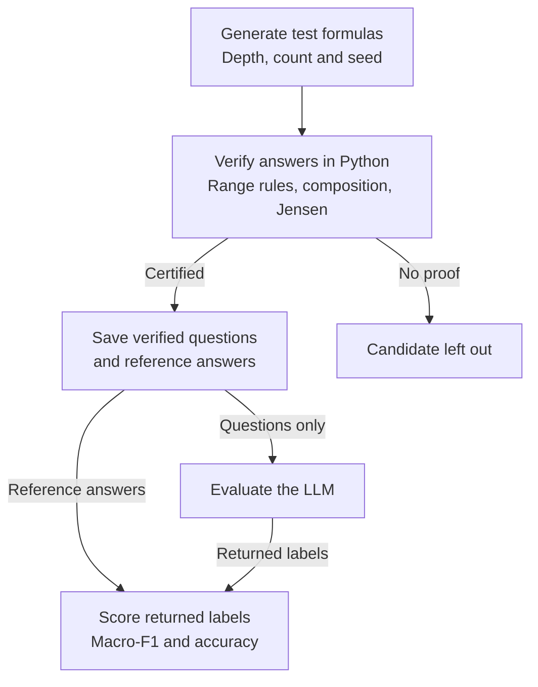

<p align="center">
  
</p>

<h1 align="center">Coconut</h1>

<p align="center">Evaluate language models on mathematical functions with verified answers. Generate tests, run a model, and see what it gets right.</p>

<p align="center"><a href="#how-it-works">How it works</a> · <a href="#generate-and-evaluate-tests">Generate tests</a> · <a href="#run-locally">Run locally</a> · <a href="docs/research/deep-study-results-v2.md">Reasoning results</a> · <a href="docs/research/cheap-depth-expand-v1.md">Fast-model results</a></p>

<!-- README-HACK:NEEDS-OWNER key="demo-video" instruction="Add the final public demo video link beside the results links above." -->
<!-- README-HACK:NEEDS-OWNER key="live-demo" instruction="Add a verified public deployment URL beside the results links above." -->

## What is Coconut?

Coconut asks an LLM to put a mathematical function into one of three categories: **convex, concave or neither** on a given interval. It checks the response against a mathematically verified answer and calculates a score.

This tests whether a model tracks signs, intervals and nested operations well enough to reach the correct classification. For example, `x³` is convex on `[0, 1]` but neither convex nor concave on `[-1, 1]`. The same formula gets a different answer when the interval changes.

## How it works

1. **Generate tests.** Choose depths, questions per depth and a seed. A generation process calls an external formula generator to build candidate expressions. Each question pairs a formula with the interval `[-1, 1]`.
2. **Verify the answers.** Coconut's separate Python worker checks the exact displayed formula and establishes its reference label. Only questions with a certified answer enter the test.
3. **Evaluate an LLM.** Send the model each formula, interval and answer instructions. Keep the reference answer out of its prompt. Use the same saved questions to evaluate another model.
4. **Calculate scores.** Compare each returned label with the reference, then report accuracy and macro-F1 overall and by depth. Keep the responses so you can inspect mistakes.



## How we know the correct answer

Coconut checks the formula itself rather than trusting the generator's proposed label. The Python worker checks signs and ranges across the whole interval, then applies **composition rules** to establish how curvature behaves when operations are nested. When a point comparison is needed, **interval arithmetic** bounds its value, including rounding error.

**Jensen's test** compares an intermediate point on the graph with the straight-line segment joining two chosen graph points. A convex graph must stay on or below that segment; a concave graph must stay on or above it. A certified violation in each direction proves the function is neither. A few passing point checks alone do not prove convexity or concavity.

For a convex or concave answer, Coconut requires a whole-interval proof and a check that rules out the opposite classification. Affine and constant functions are excluded because they satisfy both definitions. If the checks cannot establish an answer, the candidate stays out of the test. Verification can be replayed before any LLM requests.

## What is depth?

Depth describes nesting: the result of one operation becomes the input to another. For example, `log(1 + x²)` puts a square inside an addition inside a logarithm. More nesting does **not** automatically mean a harder question; an expression may simplify.

In the generation command, depth is the requested generator setting. The final expression's measured structure can differ, so it is not an exact count of reasoning steps a model must take.

## Scoring

Imagine a test with 100 questions: 33 convex, 33 concave and 34 neither. If a model gets 90 right out of 100 returned outcomes, its accuracy is 90%.

The main score, **macro-F1**, also accounts for which labels the model confuses. We calculate F1 separately for each category, give all three equal weight, and put the average on a 0–100 scale. JSON reports store scores as 0–1 fractions; the formulas below show the display scale.

```text
F1(category) = 2 × TP / (2 × TP + FP + FN)

Score = 100 × (F1(convex) + F1(concave) + F1(neither)) / 3

Accuracy = 100 × correct labels / retained model outcomes
```

**TP** counts correct predictions of a category. **FP** counts predictions assigned to that category incorrectly. **FN** counts cases of that category the model missed. For a test with model outcomes, a zero denominator gives that category an F1 of 0. With no model outcomes, no score is reported.

Malformed replies, refusals and cut-off answers count as unsuccessful model outcomes. Service failures and missing work are reported separately and leave scores incomplete. Only the final label determines the score; explanations are available for inspection.

## Run locally

Install **Bun 1.4.4**, **Node.js 24 LTS** and **uv**, then run from the repository root:

```sh
bun install --frozen-lockfile
bun run numerics:setup
bun run dev
```

Open [localhost:3200](http://localhost:3200). The API runs on port 3201.

## Generate and evaluate tests

First complete the [generator setup](docs/terminal.md#generate-your-own-task-population), which configures the external generator checkout and its Python environment. Set your OpenAI key in the ignored `apps/api/.env` file as `OPENAI_API_KEY`. Generation and reference verification run locally; model evaluation uses your key and incurs provider charges.

**Generate and verify questions:**

```sh
mkdir -p apps/api/data/private
bun run tasks:generate \
  --depths 5,10,20,40,80,160,320,512 \
  --cases-per-depth 100 --seed 42 \
  --output apps/api/data/private/tasks.json

bun run tasks:verify --input apps/api/data/private/tasks.json
```

This example requests 800 questions: 100 at each of eight depths. Change `--depths`, `--cases-per-depth` and `--seed` to build your own test. Requested depths range from 1 to 1000, with up to 1000 questions per test and near-balanced categories at each depth. Generation stops with an error if it cannot fill the requested counts within its proposal limit.

**Run an LLM and calculate scores:**

```sh
bun --env-file=apps/api/.env run eval:run \
  --input apps/api/data/private/tasks.json \
  --model gpt-6-luna --trials 1 \
  --profile one-shot-json-v1 --concurrency 4 \
  --credential-env OPENAI_API_KEY \
  --output apps/api/data/private/luna-generated-run \
  --accept-charges
```

Choose an exact OpenAI model ID available to your account. `--trials` controls responses per question: one trial here plans 800 requests. Scoring runs automatically; open `apps/api/data/private/luna-generated-run/report.json` for the result. Use a new output directory for each evaluation and a new filename for each generated test. Keep the question file and its sibling `.evidence` directory together.

These terminal commands run without the web server. The [terminal guide](docs/terminal.md) covers generator setup, profiles, repeated trials and report files.

<a id="judge-smoke-test-no-api-key-or-external-generator"></a>

## Offline check

After installation and numerical setup, verify bundled reference answers and exercise the scorer without an API key or external generator:

```sh
bun run challenge:verify --input apps/api/data/suites/challenge-v1.json
COCONUT_REVIEW_OUTPUT="$(mktemp -d)"
bun run score:report \
  --input apps/api/data/scoring/mixed-v1.input.json \
  --output "$COCONUT_REVIEW_OUTPUT/scoring-report.json"
```

The scoring example uses synthetic replies to demonstrate the calculation. See [testing](docs/testing.md) for application checks and [development](docs/development.md) for configuration.

**Built with:** TypeScript, Bun, Hono, Next.js, React, SQLite, the official OpenAI SDK, Python and python-flint/Arb.

<a id="prior-work-and-review"></a>

The external formula generator is prior work; Coconut adds reference certification, LLM execution, scoring and response inspection. [Generator attribution and provenance](docs/research/upstream-import-integration-v1.md) document the source and reuse boundaries.
